# Back of House: Design Document

## 1. Project description

Boston publishes every restaurant health inspection, but the data is buried in cryptic violation
codes that nobody reads. Back of House turns it into something diners can actually use. Each
restaurant gets a plain-English kitchen report that decodes its violations, a severity score that
separates serious issues (pests, food temperature) from minor ones (missing signage), and a
trajectory showing whether the kitchen is **Improving**, **Steady**, or **Slipping** over time.
Users can keep a personal visit log that shows what a kitchen's inspection record looked like when
they ate there, and friends can create "Where are we eating?" polls with a side-by-side kitchen
comparison to decide together.

The database is seeded with 1,000+ real records from the City of Boston Food Establishment
Inspections dataset (Analyze Boston).

## 2. User personas

### Priya, grad student

Lives near campus and eats out several times a week. She wants to know how clean a kitchen really
is, not just whether it passed.

### Marcus, the group organizer

Always the one organizing group dinners. He wants an easy way to get everyone to agree on a place
that is actually safe.

### Dana, food blogger

Tracks where she has eaten and wants to see whether those kitchens are getting better or worse
over time.

## 3. User stories

### Kitchen Reports & Visit Log (Harshitha Seetharaman)

1. As **Priya**, I want to search and filter Boston restaurants by name, neighborhood, and
   trajectory (Improving/Steady/Slipping) so that I can find places near me with clean kitchens.
2. As **Priya**, I want to open a restaurant and see its violations decoded into plain English, its
   severity score, and its trajectory so that I can understand how serious its issues really are.
3. As **Dana**, I want to add, edit, and delete entries in my visit log (date, dish, rating, notes)
   and see the kitchen's inspection status at the time of each visit so that I can keep track of
   where I have eaten and how safe it was.

### Group Picks & My Spots (Ayush Nimeshkumar Patel)

4. As **Marcus**, I want to create, edit, and delete "Where are we eating?" polls with a few
   candidate restaurants so that my friends and I can decide together.
5. As **Marcus**, I want to share a poll link so my friends can log in, vote once each, and see a
   side-by-side comparison of each restaurant's severity score and trajectory so that we pick a
   place everyone trusts.
6. As **Dana**, I want to create, edit, and delete personal "My Spots" lists with notes so that I
   can organize restaurants I like or want to try.

## 4. Design mockups

Mockups live in [`docs/mockups/`](mockups/). They are captured from the working app, using demo
accounts for the three personas, so they show the design as built: system type, near-black text
on white and light grey, one blue for actions, and colour only where it carries meaning
(green / orange / red for severity, arrows for trajectory).

| Screen                | Persona | Mockup                                                   |
| --------------------- | ------- | -------------------------------------------------------- |
| Home + instructions   | Anyone  | [`home.png`](mockups/home.png)                           |
| Sign in               | Anyone  | [`login.png`](mockups/login.png)                         |
| Sign up               | Anyone  | [`register.png`](mockups/register.png)                   |
| Email code            | Anyone  | [`verify.png`](mockups/verify.png)                       |
| Kitchen Reports       | Priya   | [`restaurants.png`](mockups/restaurants.png)             |
| Kitchen Weather       | Priya   | [`kitchen-weather.png`](mockups/kitchen-weather.png)     |
| Kitchen Report detail | Priya   | [`restaurant-detail.png`](mockups/restaurant-detail.png) |
| Visit Log             | Dana    | [`visits.png`](mockups/visits.png)                       |
| Taste × Kitchen map   | Dana    | [`visits-taste-map.png`](mockups/visits-taste-map.png)   |
| Log a visit           | Dana    | [`visit-form.png`](mockups/visit-form.png)               |
| Group Picks           | Marcus  | [`polls.png`](mockups/polls.png)                         |
| Poll + comparison     | Priya   | [`poll-detail.png`](mockups/poll-detail.png)             |
| My Spots              | Dana    | [`spots.png`](mockups/spots.png)                         |
| Mobile                | Priya   | [`mobile.png`](mockups/mobile.png)                       |

### Home + instructions

The product-page intro: what Back of House does and where to start.

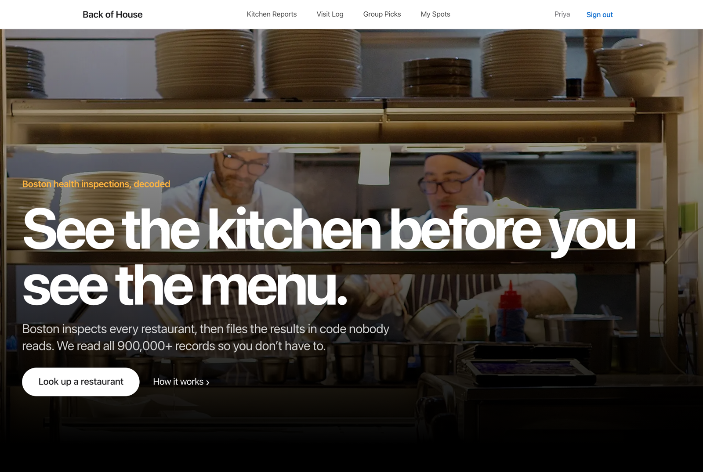

### Sign in and sign up

Email and password, or Continue with Google. A new account gets a 6-digit code by email before
its first sign-in.

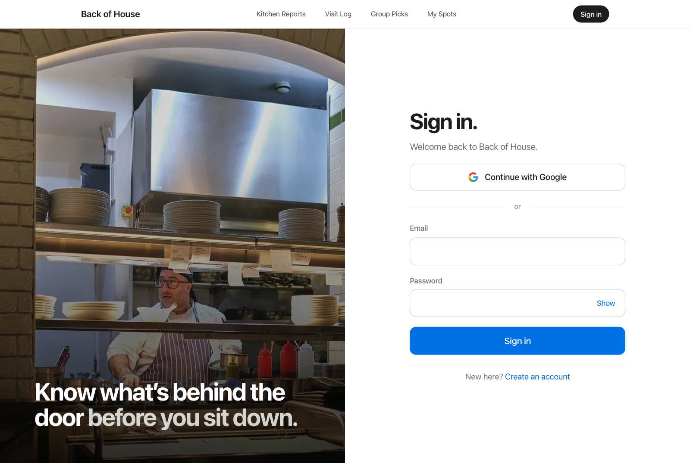

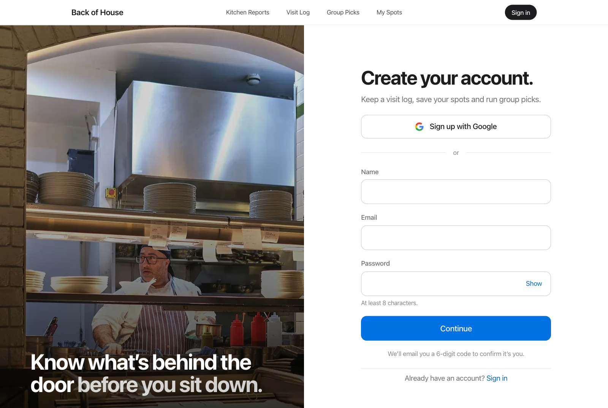

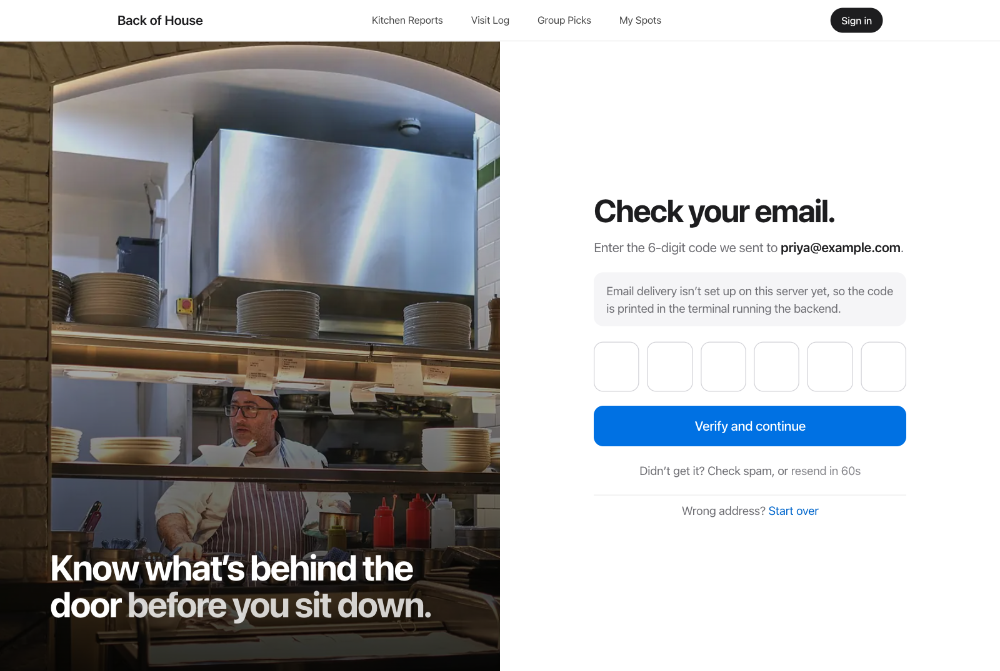

### Kitchen Reports (stories 1 and 2)

Priya searches by name and filters by neighborhood and trajectory. Each card shows the headline
severity score and whether the kitchen is Improving, Steady or Slipping.

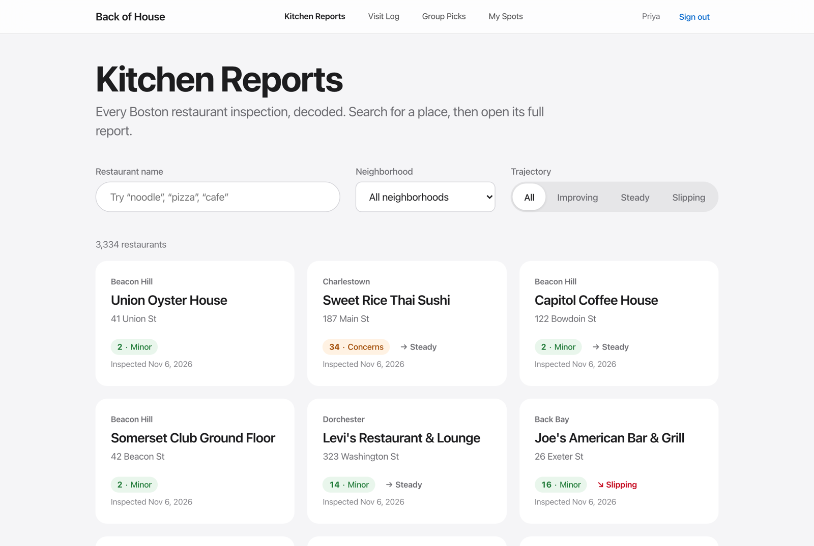

Kitchen Weather, above the search: a dot map of Boston showing where inspectors found concerns
each quarter since 2023. Press play to watch it change, or pick a neighborhood to list its
kitchens below.

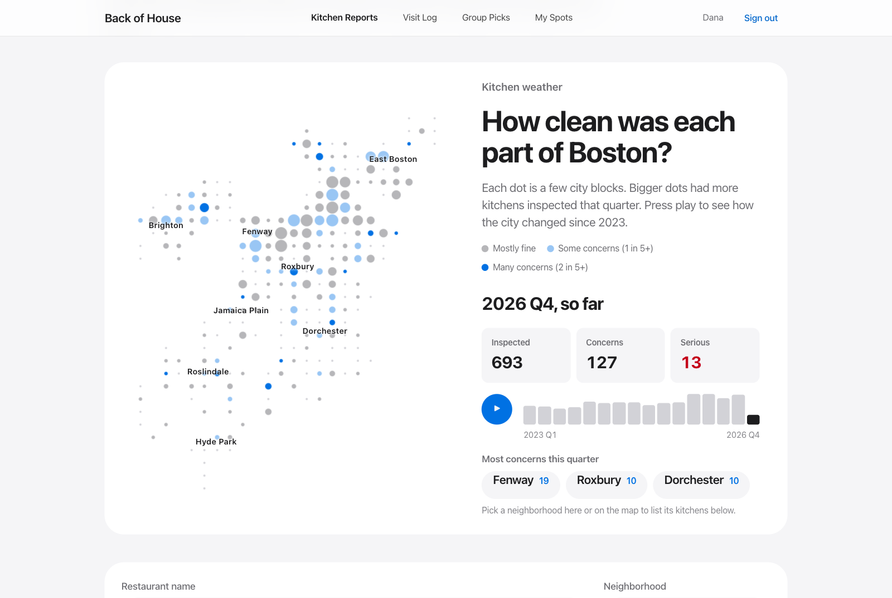

Opening a restaurant shows its severity meter, the trajectory chart of recent inspections, and
every violation decoded into plain English.

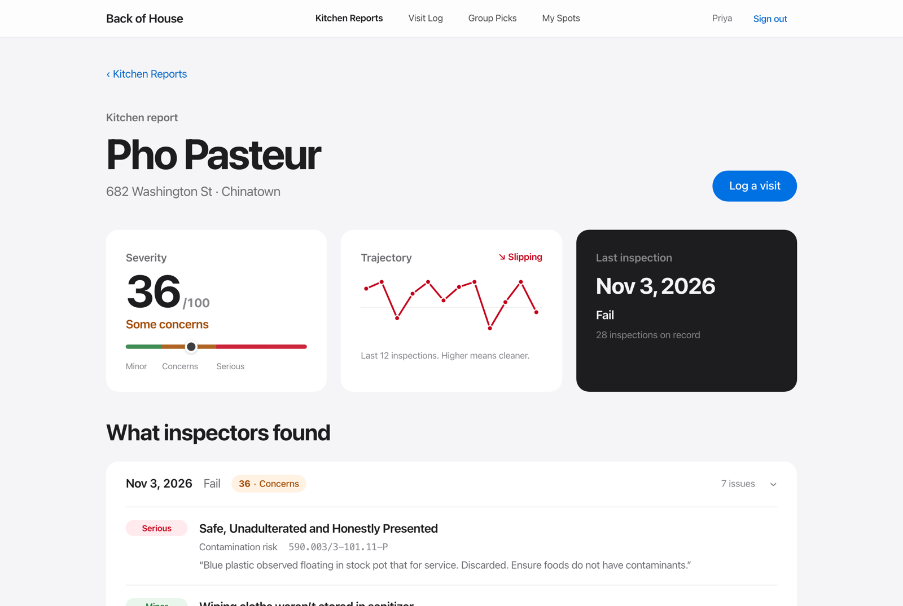

### Visit Log (story 3)

Dana's meals, each paired with what the kitchen's inspection record looked like on that day,
grouped by month. A stats row sums up the log, and "Share my 2026" turns it into a recap card.
Add, edit and delete visits from this page.

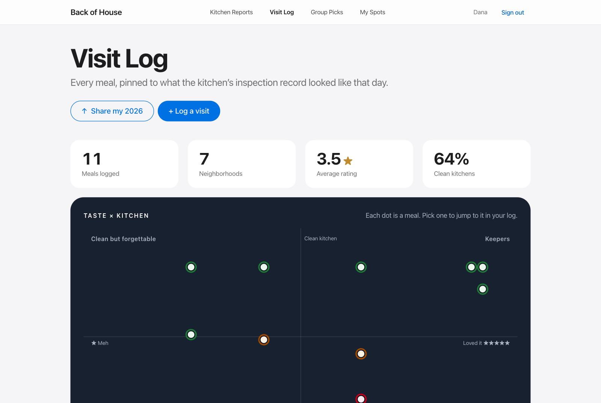

The Taste × Kitchen map plots every meal by rating and kitchen score. Picking a dot or a corner
(Keepers, Worth a second look, Clean but forgettable, Skip next time) filters the log and jumps
to that visit.

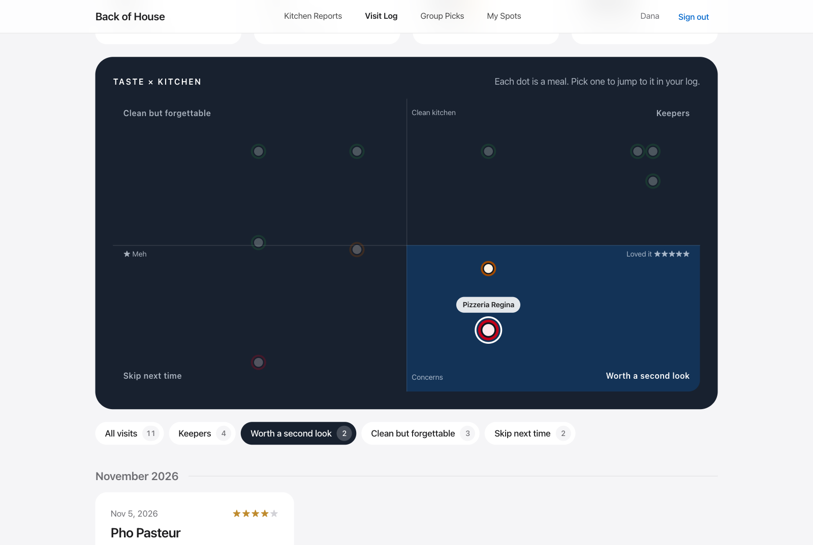

Logging a visit: pick the restaurant, then the date, dish, stars and notes.

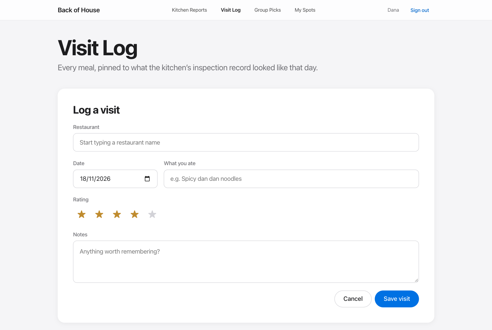

### Group Picks (stories 4 and 5)

Marcus's polls: the ones he created (with Edit and Delete) and the ones friends shared that he
voted in (view and vote only).

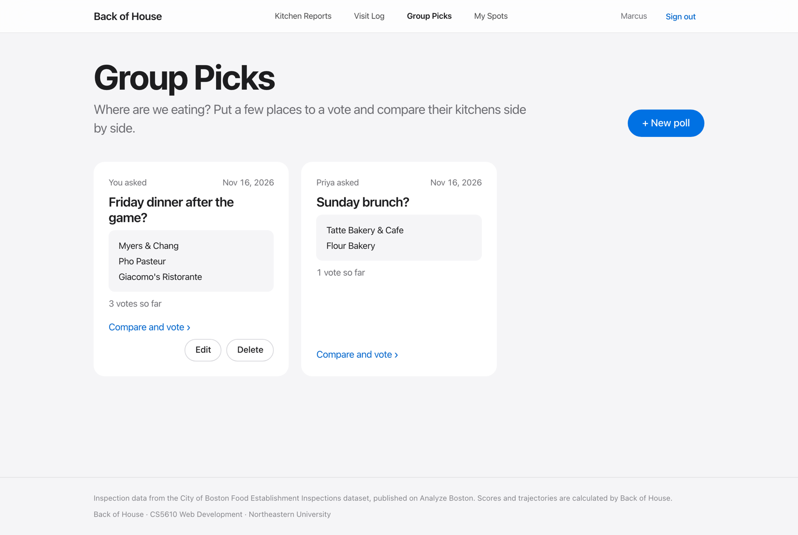

The shared poll page. Each candidate's severity, trend and last inspection sit side by side,
with live vote counts, who voted for what, and "Most votes" / "Cleanest kitchen" highlights.
The blue outline marks the viewer's own vote, which they can change any time.

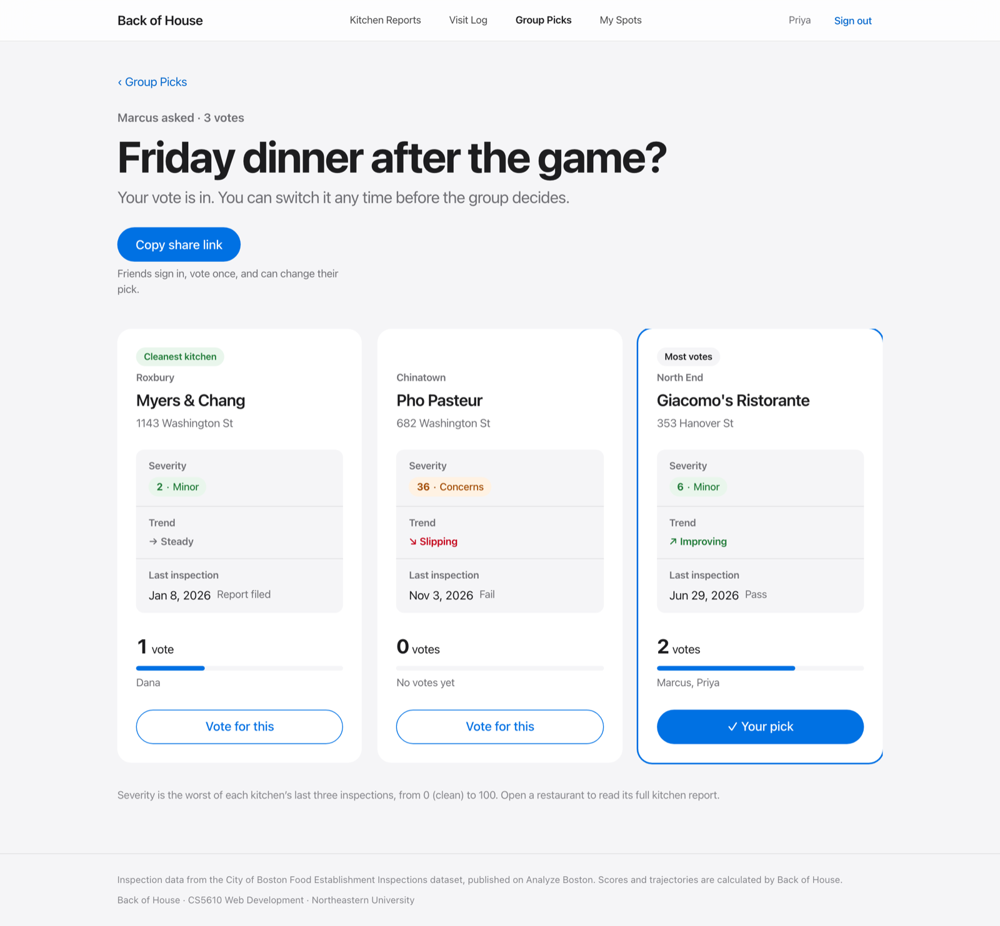

### My Spots (story 6)

Dana's personal lists with a note on each restaurant and today's kitchen score next to it.
Create, edit (rename, add, remove, change notes) and delete lists.

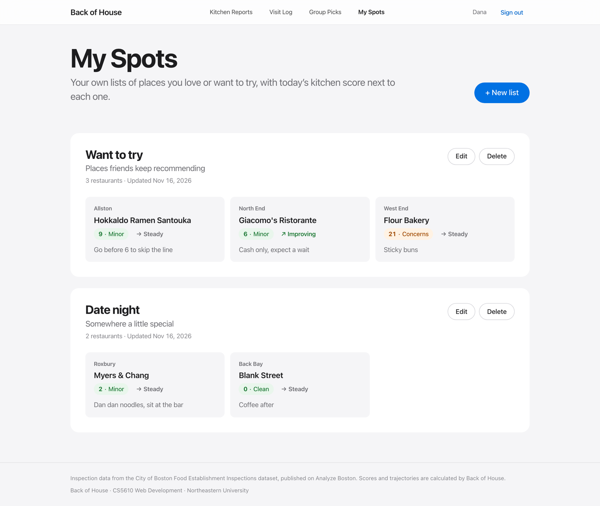

### Mobile

Every page is responsive. On a phone the comparison columns stack into one column.

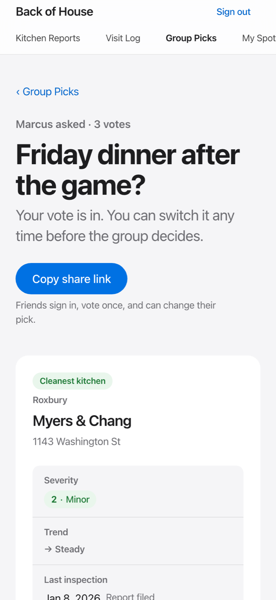
